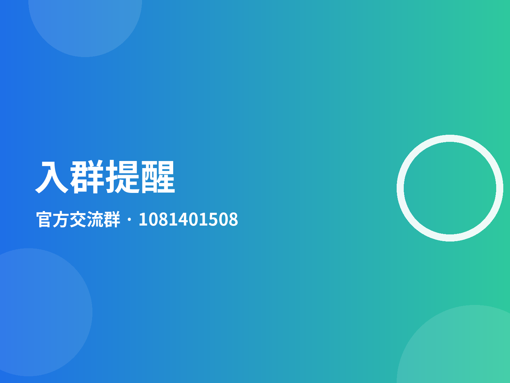

## TENC Store 的开端

一切都从一块手表开始：想在手腕上自由装应用、第一时间追新版本，却被各种应用市场绕得团团转。TENC Store 由此诞生——直连 GitHub，把搜索、项目介绍、下载安装、测试反馈、应用上传全部装进手表里。从第一行代码到完整开源，它只做一件事：让你的手表用上整个 GitHub 的应用生态。

## 全新版本 v1.28 发布

本次更新：
- 输入界面全面重做：圆角输入卡片、聚焦高亮描边、醒目光标
- 新增取消 / 确定圆形按钮，操作更顺手
- 输入为空时确定按钮自动置灰，防止误触
- 首页公告轮播卡片去掉底部标题行，画面更简洁
升级方式：设置 → 检查更新，发现新版本一键下载安装（不强制）。

## 征集需测试应用

你的应用想让更多表友戴上手腕实测吗？TENC Store 现面向所有开发者征集待测试应用。
投稿方式：加入 QQ 群 1081401508，按群公告提交你的 GitHub 仓库地址即可。
收录后应用会出现在商店「测试项目」页，测试者可直接下载体验，并通过应用内反馈把建议和 Bug 发到你的邮箱。快来进群投稿吧！

## 入群提醒

欢迎加入 TENC Store 官方交流群（QQ 群 1081401508）！
在这里你可以：
- 第一时间获取新版本发布与功能预告
- 开发者进群投稿，申请应用收录与测试
- 反馈问题和建议，直达开发者
进群后请查看群公告了解投稿规范，期待你的加入！
